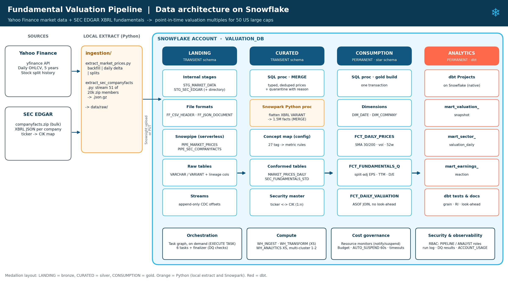
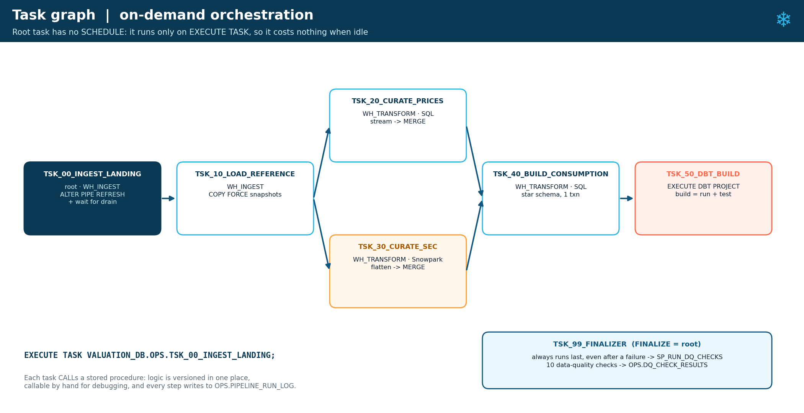
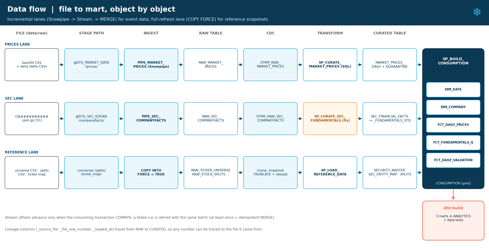
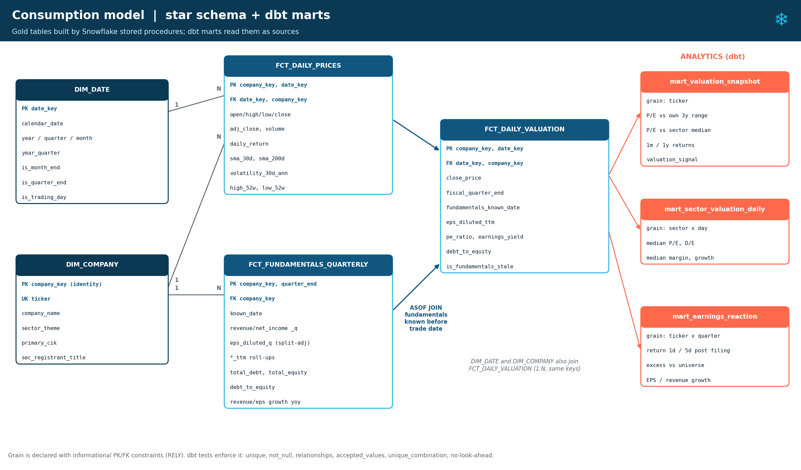
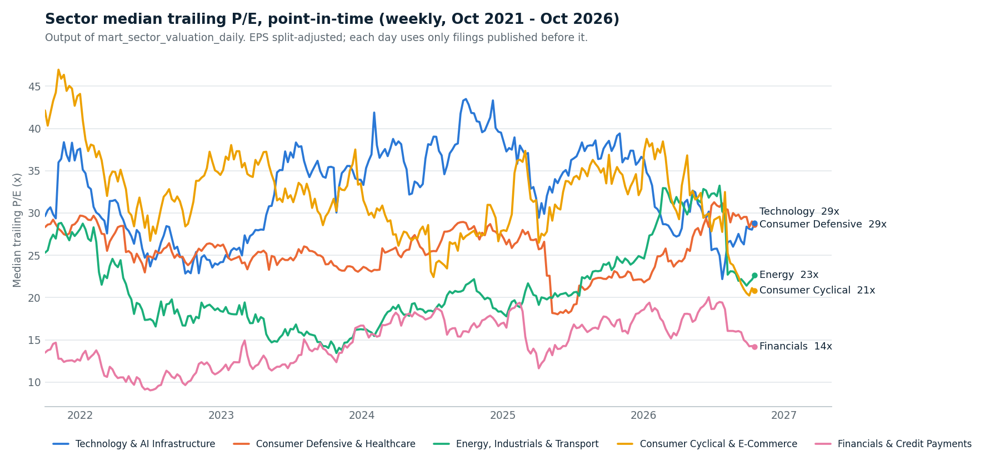

# Snowflake Fundamental Valuation Pipeline

**An on-demand ELT pipeline built natively on Snowflake. It joins daily market data (Yahoo Finance) with SEC EDGAR XBRL financial statements to produce point-in-time valuation multiples (P/E, earnings yield, leverage, growth) for 50 US large caps.**




---

## Contents
1. [Overview and purpose](#1-overview-and-purpose)
2. [Data](#2-data)
3. [Pipeline infrastructure: Snowflake services used](#3-pipeline-infrastructure-snowflake-services-used)
4. [Data flow](#4-data-flow)
5. [Data model: star schema and dbt marts](#5-data-model-star-schema-and-dbt-marts)
6. [Design decisions](#6-design-decisions) (zones, landing vs stage, **table types**, clustering, warehouses, notifications)
7. [Finance engineering details](#7-finance-engineering-details)
8. [Cost and resource monitoring](#8-cost-and-resource-monitoring)
9. [Repository structure](#9-repository-structure)
10. [How to run it](#10-how-to-run-it)
11. [Sample output](#11-sample-output)
12. [Limitations and next steps](#12-limitations-and-next-steps)

---

## 1. Overview and purpose

**Business question:** *Is a stock cheap or expensive relative to its own history and to its sector, using only information that was public on each day?*

Answering it means joining two very different datasets on a shared business entity:

| | Dataset 1: Market performance | Dataset 2: Corporate financials |
|---|---|---|
| Source | Yahoo Finance (`yfinance`) | SEC EDGAR bulk *companyfacts* (XBRL) |
| Grain | Daily, per ticker | Per filing / fiscal period, per SEC registrant (CIK) |
| Shape | Tabular CSV | Deeply nested JSON (facts -> taxonomy -> concept -> unit -> array) |
| Velocity | Fast: daily delta files | Slow: quarterly 10-Q / annual 10-K |
| Join key | Ticker | CIK (needs entity resolution to ticker) |

The project demonstrates, in one coherent pipeline:

- **Snowflake data engineering**: internal stages, file formats, Snowpipe, streams, a task graph with a finalizer, SQL and Snowpark stored procedures, transactions, MERGE-based CDC, ASOF joins, RBAC, resource monitors and budgets, dbt Projects on Snowflake, Git integration.
- **Data modelling**: medallion zones, star schema with a shared date dimension, informational constraints, explicit grains.
- **Performance and cost**: micro-partition pruning, clustering strategy, warehouse sizing and isolation, multi-cluster scale-out.
- **Python**: a selective zip extractor, an incremental market-data extractor, a scripted stage uploader, and a Snowpark DataFrame procedure.
- **Financial-data judgement**: point-in-time correctness (no look-ahead bias), split adjustment, YTD-to-quarter derivation, XBRL tag standardisation, and entity resolution when a company changes registrant.

## 2. Data

| File(s) | Content | Rows / size | In this repo? |
|---|---|---|---|
| `data/raw/dataset1/backfill/prices_backfill_<start>_<end>.csv` | Daily OHLCV, adjusted close, dividends, splits, 50 tickers | ~62,700 rows for 5 years | **No:** generate with the script |
| `data/raw/dataset1/daily/prices_YYYY-MM-DD.csv` | One **delta** file per trading day (for the incremental run) | 50 rows per file | **No:** generate with the script |
| `data/raw/dataset1/reference/stock_splits.csv` | Full split history since 2010 (incl. NVDA 4:1 2021, GE 1:8 reverse) | ~31 rows | **No:** generate with the script |
| `data/raw/dataset2/companyfacts/CIK##########.json.gz` | SEC XBRL company facts, byte-identical to the SEC archive, gzip | 51 files · 15 MB (223 MB raw) | Yes (public domain) |
| `data/raw/dataset2/reference/company_tickers.json.gz` | SEC ticker -> CIK mapping (used for entity validation) | ~10k entities | Yes (public domain) |
| `config/ticker_universe.csv` | The 50-ticker universe, sector themes and SEC registrant(s) | 51 rows | Yes |

**Yahoo Finance data is not redistributed.** Yahoo's terms do not allow republishing its data, so Dataset 1 is excluded from Git (`.gitignore`). Recreate it in about a minute with `ingestion/extract_market_prices.py` (see [Section 10](#10-how-to-run-it), step 0). SEC EDGAR data is US-government public domain and is included.

**How it was sourced (and kept small on disk).** `ingestion/extract_sec_companyfacts.py` reads the **central directory** of the 1.4 GB `companyfacts.zip` and streams only the 51 needed members (out of ~20,400) straight into gzip files. It never unzips the archive. `ingestion/extract_market_prices.py` produces the backfill, the daily deltas and the split history. See [`data/raw/README.md`](data/raw/README.md).

**Data-quality findings during sourcing** (all handled in the pipeline):
- The CIK listed for **HD** in the original spec (354908) belongs to **FLIR Systems**; Home Depot is 354950.
- **XOM** moved its filings to a new holding-company registrant (CIK 2115436) in 2026. Ticker-to-CIK is therefore **one-to-many** (`cik_role` = primary / predecessor). The new file even serialises `cik` as a string instead of a number (schema drift absorbed by a cast at ingestion).
- **Visa** reports EPS only by share class, which companyfacts omits, so V gets no P/E. This is flagged by a DQ check rather than hidden.

## 3. Pipeline infrastructure: Snowflake services used

| Service | Role in this pipeline | Where |
|---|---|---|
| **Internal stages** + directory tables | File landing area (immutable, replayable), one per source system | `snowflake/01_landing/01_file_formats_and_stages.sql` |
| **File formats** | Reusable CSV / JSON parsing rules (gzip auto-detected) | same |
| **Snowpipe** | Serverless, idempotent loading of event-style files (prices, SEC docs) | `01_landing/03_pipes_and_streams.sql` |
| **COPY INTO ... FORCE** | Full-refresh loading of reference snapshots | `stored_procedures/sql/sp_load_reference_data.sql` |
| **Streams** (append-only) | Change tracking: each run processes only new raw rows | `01_landing/03_pipes_and_streams.sql` |
| **Stored procedures (SQL)** | Ingestion trigger and wait, curation with quarantine and MERGE, gold build, DQ checks | `stored_procedures/sql/` |
| **Snowpark Python procedure** | Flattening and standardising nested SEC XBRL JSON with the DataFrame API | `stored_procedures/python/` |
| **Tasks / task graph** | On-demand DAG (no schedule) with parallel branches and a **finalizer** | `04_orchestration/02_task_graph.sql` |
| **Virtual warehouses** | Workload-isolated XS warehouses; multi-cluster for analytics | `00_setup/02_warehouses.sql` |
| **Resource monitors + budget** | Hard stop on warehouse credits; alerts covering serverless spend | `00_setup/03_cost_guardrails.sql` |
| **dbt Projects on Snowflake** | Tested analytics marts on top of the gold layer, run by a task | `dbt/`, `07_dbt/` |
| **Git repository** (optional) | Deploy SQL, Python and dbt straight from GitHub | `00_setup/04_git_integration_optional.sql` |
| **RBAC** | `VALUATION_PIPELINE` (owner/runner) and `VALUATION_ANALYST` (read-only) | `00_setup/01_roles_database_schemas.sql` |
| **Time Travel / zero-copy clone** | Recovery and dev copies of the permanent gold layer | (demo in guide 2) |



## 4. Data flow



1. **Land.** Files are uploaded to the internal stages (Snowsight UI or `ingestion/upload_to_stage.py`).
2. **Ingest.** The root task runs `SP_INGEST_LANDING`. It issues `ALTER PIPE ... REFRESH` on both pipes and **waits** (polling `SYSTEM$PIPE_STATUS`) until they have drained, because Snowpipe is asynchronous.
3. **Reference.** Universe, split history and SEC ticker map are fully reloaded, building `SECURITY_MASTER` (validated against the SEC's own map), `SEC_ENTITY_MAP` and `STOCK_SPLITS`.
4. **Curate (parallel).**
   - *Prices (SQL):* the stream is consumed inside an explicit transaction. Rows are typed with `TRY_*`, invalid rows go to quarantine with a reason, and valid rows are MERGEd on `(ticker, trade_date)` with hash-based change detection.
   - *SEC (Snowpark):* VARIANT documents are flattened to ~1.5M facts and MERGEd on a SHA-256 key, directly from the stream. Then the priority-ranked concept map produces first-reported standard metrics.
5. **Gold.** One transaction rebuilds the star schema: split-adjusted EPS, discrete quarters from YTD chains, TTM, leverage, and an `ASOF JOIN` of prices to fundamentals known *before* each trade date.
6. **Analytics.** `EXECUTE DBT PROJECT ... build` runs and tests three marts.
7. **Finalize.** Ten data-quality checks write to `OPS.DQ_CHECK_RESULTS` even if an earlier task failed. Every step logs to `OPS.PIPELINE_RUN_LOG`.

## 5. Data model: star schema and dbt marts



| Table | Grain | Notes |
|---|---|---|
| `DIM_DATE` | calendar day (2005-2030) | Shared/conformed; `is_trading_day` derived from observed prices |
| `DIM_COMPANY` | company (SCD1) | Identity surrogate key kept stable via MERGE |
| `FCT_DAILY_PRICES` | company x trading day | SMA 30/200, 30-day annualised volatility, 52-week range |
| `FCT_FUNDAMENTALS_QUARTERLY` | company x fiscal quarter | Discrete quarters, TTM, split-adjusted EPS, D/E, margins, growth, `known_date` |
| `FCT_DAILY_VALUATION` | company x trading day | Point-in-time P/E, earnings yield, leverage, staleness flag |
| `mart_valuation_snapshot` (dbt) | company | P/E percentile vs own 3-year history and vs sector median; momentum; valuation signal |
| `mart_sector_valuation_daily` (dbt) | sector x day | Median P/E, D/E, margin, growth |
| `mart_earnings_reaction` (dbt) | company x quarter | 1d/5d returns after each filing, excess vs equal-weighted universe |

dbt tests: `unique`, `not_null`, `relationships`, `accepted_values`, custom generic tests `positive_value` and `unique_combination` (no external packages), and a singular **no-look-ahead** test.

## 6. Design decisions

The full reasoning, written for interview preparation, is in **[Guide 1: Concepts & Design Decisions (PDF)](docs/guides/01_Snowflake_Concepts_and_Design_Decisions.pdf)**. The key decisions in brief:

### 6.1 Zones
`LANDING` (bronze, as delivered + lineage) -> `CURATED` (silver, typed, validated, de-duplicated, conformed) -> `CONSUMPTION` (gold, star schema + business rules) -> `ANALYTICS` (dbt marts). `OPS` holds procedures, tasks, logs and DQ results.

### 6.2 Is the stage the landing zone?
The landing zone has **two halves**. The **stage** holds the immutable files (the replayable source of truth), and the **raw tables** are the first queryable, lineage-stamped copy. In production the file half would be an S3 bucket (external stage + storage integration, lifecycle rules, shared with other consumers). This project uses internal stages to avoid needing a cloud account; the S3 version is in `snowflake/99_production_variants/`.

### 6.3 Table types per zone

| Zone | Type | Reasoning |
|---|---|---|
| LANDING | **TRANSIENT** schema | Re-loadable copy of immutable staged files. Fail-safe (7 days of extra, non-queryable storage) would be cost without benefit; 1 day of Time Travel still covers mistakes. |
| CURATED | **TRANSIENT** schema | Rebuilt deterministically by idempotent procedures from LANDING / the stage. *If staged files were purged after load, CURATED would become the system of record and should be PERMANENT.* |
| CONSUMPTION | **PERMANENT** | What consumers and dbt read: Time Travel / UNDROP after a bad deploy, zero-copy clones for dev. |
| ANALYTICS | **PERMANENT** | Consumer-facing dbt marts. |
| Inside procedures | **TEMPORARY** | Batch scratch tables (`TMP_PRICE_BATCH`), dropped with the session. |

Rule of thumb: *make a table permanent only if losing it means losing information.* One caveat: streams read the table's change history, so an on-demand pipeline must consume them within `MAX_DATA_EXTENSION_TIME_IN_DAYS` (14 by default), or they go stale.

### 6.4 Micro-partitions and clustering
Micro-partitions and their min/max metadata are automatic; pruning is the main performance lever. **No clustering keys are defined.** Every table here fits in a few micro-partitions, so Automatic Clustering would spend credits for no gain. Instead the gold build inserts `ORDER BY (trade_date, ticker)`, which gives natural clustering for free. At full-market scale I would use `(trade_date, ticker)` on the daily facts, `(cik, concept)` on SEC facts, and Search Optimization for point lookups. Analysis queries are in `snowflake/06_performance/`.

### 6.5 Warehouses and avoiding bottlenecks
Three **X-Small** warehouses isolate workloads: `WH_INGEST`, `WH_TRANSFORM` (30-minute statement timeout) and `WH_ANALYTICS` (**multi-cluster 1-2, ECONOMY**). Sizing follows data volume: ~250 MB in total, ~1.5M facts, minutes on XS. **Scale up** when a query spills; **scale out** when queries queue; **separate** warehouses when workloads contend. All warehouses auto-suspend after 60 seconds and sit under resource monitors.

### 6.6 Notifications and triggering Snowpipe
Internal stages emit no cloud events, so `AUTO_INGEST` is not available. A pipe is triggered via the **Snowpipe REST API** (`insertFiles`) or `ALTER PIPE ... REFRESH`. For an **on-demand batch**, the root task refreshes the pipes and waits for them to drain: no key-pair setup and no service to run. With S3 the production design is `AUTO_INGEST = TRUE`, with bucket `ObjectCreated` notifications sent to the pipe's Snowflake-managed **SQS** queue (see `99_production_variants/s3_external_stage_auto_ingest.sql`).

### 6.7 Stored procedures with tasks
Every task just `CALL`s a procedure. The logic is versioned in one place (`snowflake/stored_procedures/`), can be called by hand for debugging, handles its own transaction and exceptions, and writes a run-log row. Tasks only orchestrate.

### 6.8 Where Snowpark and dbt fit
**Snowpark** is used where code reads better than SQL: the 4-level XBRL flattening and rule-based standardisation, written as small, testable DataFrame functions that compile to SQL and run in the warehouse. **dbt** sits *on top of* the gold layer, so Snowpipe, Streams, Tasks and Snowpark remain the pipeline. dbt contributes marts, tests, docs and lineage, and runs inside Snowflake as the last task.

## 7. Finance engineering details

- **Point-in-time correctness.** First-reported values only, `known_date` = latest filing date of any input, and `ASOF JOIN ... MATCH_CONDITION (trade_date > known_date)`. Enforced by a DQ check and a dbt test.
- **Split adjustment.** Each per-share fact is divided by the product of all splits *after its filing date* (`EXP(SUM(LN(ratio)))`), *before* any arithmetic. Yahoo prices are back-adjusted to today's share count, so without this NVDA's P/E jumps 10x at its 2024 split.
- **Discrete quarters from YTD.** Facts sharing a `period_start` form a cumulative chain (Q1 -> H1 -> 9M -> FY); differencing yields every quarter, including the never-filed Q4 and YTD-only cash flows. Check: Apple's derived Q4 FY2025 revenue = $102.5bn.
- **Tag standardisation.** `CURATED.REF_XBRL_CONCEPT_MAP` maps 27 concept rows to 12 standard metrics by priority (e.g. bank revenue `RevenuesNetOfInterestExpense`). Missing `Liabilities` are derived and flagged.
- **Not meaningful is NULL.** No P/E when TTM EPS <= 0 (earnings yield kept); no leverage ratios with negative equity (MCD, SBUX, HD); sector medians instead of means.

## 8. Cost and resource monitoring

**Estimate:** a full pipeline run uses about **0.1-0.2 credits** (minutes on XS warehouses). Snowpipe costs ~0.001 credits for all files, and storage is negligible. Including interactive exploration, the whole project should use **~4-7 credits (~GBP 10-20)**, which is **below the GBP 30 ceiling** and fully covered by the trial's USD 400 credit.

**Guardrails:** XS warehouses with 60 s auto-suspend and statement timeouts; resource monitors (account 10 credits, project 6 credits; notify, suspend, then suspend immediately); an account budget (12 credits, covering serverless); and a task graph with **no schedule**. Monitoring queries over `ACCOUNT_USAGE` (metering, pipe usage, query attribution, storage) and `INFORMATION_SCHEMA` (tasks, copy history) are in `snowflake/05_monitoring/`.

Details and the "what could make it expensive" list: **[Guide 3: Cost Estimate & Resource Monitoring (PDF)](docs/guides/03_Cost_Estimate_and_Resource_Monitoring.pdf)**.

## 9. Repository structure

```
.
├── config/ticker_universe.csv            # 50 tickers, sectors, SEC registrant(s) (1:n)
├── data/raw/                             # files to upload to the Snowflake stages
│   ├── dataset1/                         # Yahoo Finance prices + splits (NOT committed: generated
│   │                                     #   by ingestion/extract_market_prices.py)
│   └── dataset2/{companyfacts,reference}/     # SEC XBRL JSON (.gz) + ticker map
├── ingestion/                            # Python that runs OUTSIDE Snowflake
│   ├── extract_market_prices.py          # backfill | daily delta | splits
│   ├── extract_sec_companyfacts.py       # selective streaming extract from the SEC zip
│   └── upload_to_stage.py                # optional scripted PUT + EXECUTE TASK
├── snowflake/                            # everything that runs IN Snowflake (in order)
│   ├── 00_setup/                         # roles, database/zones, warehouses, cost guardrails, Git
│   ├── 01_landing/                       # file formats, stages, raw tables, pipes, streams
│   ├── 02_curated/                       # XBRL concept map, curated tables
│   ├── 03_consumption/                   # star schema DDL
│   ├── stored_procedures/
│   │   ├── sql/                          # ingest, reference, curate prices, build gold, DQ
│   │   └── python/                       # Snowpark procedure (.py) + its registration (.sql)
│   ├── 04_orchestration/                 # ops tables, task graph, run & watch
│   ├── 05_monitoring/                    # cost + pipeline observability queries
│   ├── 06_performance/                   # clustering & pruning analysis
│   ├── 07_dbt/                           # deploy/execute dbt Projects on Snowflake
│   ├── 99_production_variants/           # S3 + storage integration + AUTO_INGEST via SQS
│   └── 99_teardown.sql
├── dbt/fundamental_valuation/            # dbt project (sources = CONSUMPTION, marts = ANALYTICS)
└── docs/
    ├── guides/                           # 3 PDF guides (concepts, step-by-step, cost)
    └── images/                           # diagrams used in this README
```

## 10. How to run it

The full walkthrough with expected row counts and checks is **[Guide 2: Step-by-Step Implementation (PDF)](docs/guides/02_Step_by_Step_Implementation_Guide.pdf)**. In short:

0. **Generate the market data locally** (Yahoo Finance data is not included in the repo):
   ```bash
   pip install -r requirements.txt
   python ingestion/extract_market_prices.py backfill --start 2021-10-01 --end 2026-09-30
   python ingestion/extract_market_prices.py delta    --start 2026-10-01 --end 2026-10-13
   python ingestion/extract_market_prices.py splits   --start 2010-01-01
   ```
   This writes `data/raw/dataset1/{backfill,daily,reference}/`. Any date range works: pick a recent 5-year window for the backfill and the following trading days for the deltas. Your numbers will then differ slightly from the sample output below.
1. Create a Snowflake trial (Enterprise edition, AWS London) and verify your e-mail.
2. Run `snowflake/00_setup/01` -> `02` -> `03` as ACCOUNTADMIN (roles, zones, warehouses, **cost guardrails**).
3. As `VALUATION_PIPELINE`, run `01_landing/*`, `02_curated/*`, `03_consumption/*`, `04_orchestration/01_ops_tables.sql`.
4. Upload `data/raw` + `config` files to the stage paths listed in `01_landing/01_file_formats_and_stages.sql` (Snowsight **+ Files**, or `python ingestion/upload_to_stage.py initial`). Hold back the `daily/` files.
5. Upload `sp_curate_sec_fundamentals.py` to `@OPS.STG_CODE`, then run every file in `stored_procedures/`.
6. Run `04_orchestration/02_task_graph.sql`, then deploy dbt (`07_dbt/deploy_dbt_project.sql` or Snowsight Workspaces).
7. `EXECUTE TASK VALUATION_DB.OPS.TSK_00_INGEST_LANDING;` and watch it in Monitoring > Task History.
8. Upload a few `daily/` files and execute again: only the new rows flow through.
9. When finished: `snowflake/99_teardown.sql`.

The SEC files are already in the repo. To refresh them from a newer SEC bulk archive (optional), download `companyfacts.zip` from [SEC EDGAR bulk data](https://www.sec.gov/search-filings/edgar-application-programming-interfaces) and run:
```bash
python ingestion/extract_sec_companyfacts.py --zip companyfacts.zip --user-agent "Your Name you@example.com"
```

## 11. Sample output



Relative-value screen (`ANALYTICS.MART_VALUATION_SNAPSHOT`, as of 2026-10-13, cheapest vs own 3-year P/E history):

| Ticker | Sector | P/E | Sector median P/E | P/E percentile (3y) | 1y return | Signal |
|---|---|---|---|---|---|---|
| PEP | Consumer Defensive & Healthcare | 16.0 | 28.6 | 0.00 | -11.7% | CHEAP_VS_OWN_HISTORY |
| NKE | Consumer Cyclical & E-Commerce | 17.0 | 20.8 | 0.01 | -44.0% | CHEAP_VS_OWN_HISTORY |
| MCD | Consumer Cyclical & E-Commerce | 19.2 | 20.8 | 0.01 | -18.6% | CHEAP_VS_OWN_HISTORY |
| NVDA | Technology & AI Infrastructure | 28.9 | 28.8 | 0.03 | +25.1% | CHEAP_VS_OWN_HISTORY |
| ADBE | Technology & AI Infrastructure | 13.2 | 28.8 | 0.04 | -30.0% | CHEAP_VS_OWN_HISTORY |

*(Figures come from validating the pipeline's SQL locally against the same raw data; your Snowflake run should reproduce them.)*

## 12. Limitations and next steps

- GAAP EPS includes one-off items (e.g. Honeywell's 2026 separation gain makes its P/E look low); adjusted EPS would need non-GAAP data.
- Multi-class EPS filers (Visa) have no EPS in companyfacts. Derive EPS from net income / diluted shares as a fallback.
- If the SEC snapshot lacks a company's latest 10-Q, its ratios become stale (flagged by `is_fundamentals_stale`).
- Next: S3 + `AUTO_INGEST`; Dynamic Tables for the gold layer; Data Metric Functions for DQ; masking / row-access policies; a Streamlit-in-Snowflake front end.

---
*Data: SEC EDGAR (public domain, US government; included). Yahoo Finance via `yfinance` (personal/educational use, subject to Yahoo's terms; not redistributed here, generated locally by the extraction script).*
