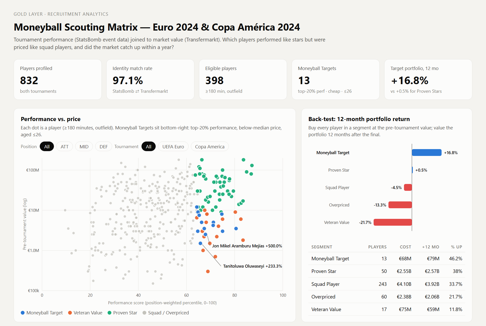
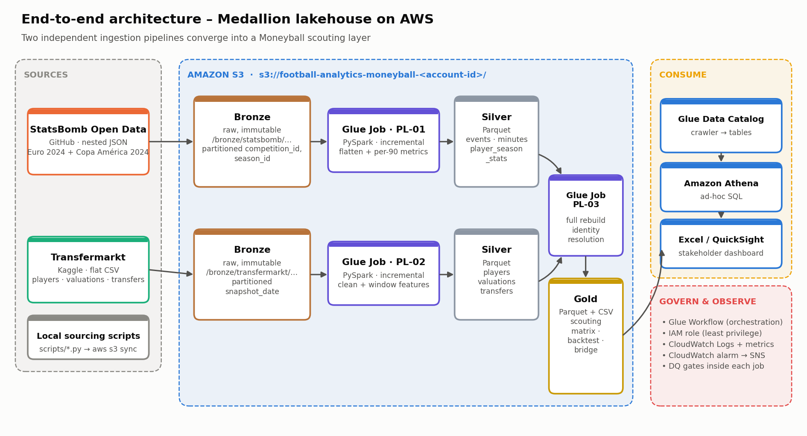
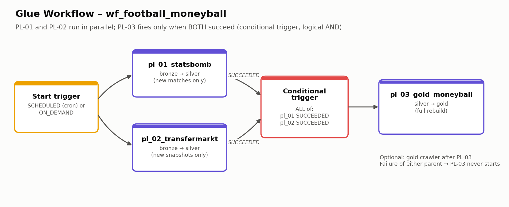
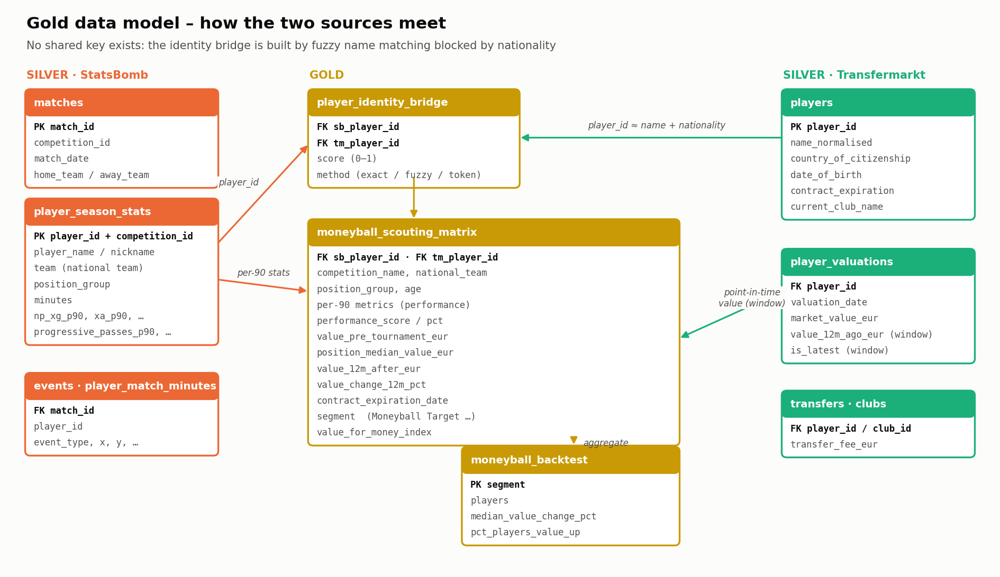
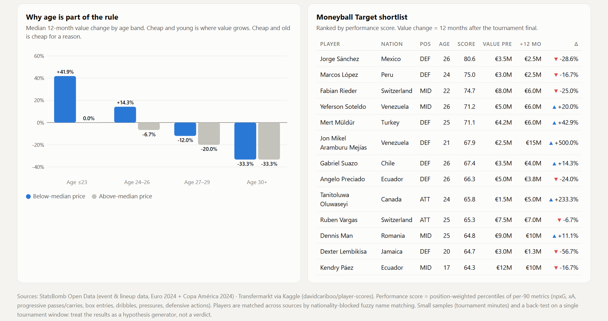

# ⚽ Moneyball on AWS — A PySpark Medallion Lakehouse for Football Scouting

> **Can tournament performance find undervalued players before the market does?**
> Two radically different sources (deeply nested StatsBomb event JSON and relational Transfermarkt CSVs) are ingested by
> independent, incremental **AWS Glue (PySpark)** pipelines. They converge in a Gold layer that resolves player identities
> across sources with no shared key, scores every player, and **back-tests** the scouting rule against what the
> transfer market actually did over the following 12 months.




---

## Contents
1. [The story: Moneyball at Euro 2024 & Copa América 2024](#1-the-story)
2. [Architecture](#2-architecture)
3. [Data sources](#3-data-sources)
4. [The pipelines](#4-the-pipelines)
5. [Orchestration: Glue Workflow](#5-orchestration-glue-workflow)
6. [Incremental processing](#6-incremental-processing)
7. [Observability & data quality](#7-observability--data-quality)
8. [Gold data model](#8-gold-data-model)
9. [Engineering challenges](#9-engineering-challenges-and-how-they-were-solved)
10. [Results & insights](#10-results--insights)
11. [Data limitations](#11-data-limitations)
12. [Reproduce it](#12-reproduce-it)
13. [Repository structure](#13-repository-structure)
14. [What I would do next](#14-what-i-would-do-next)

---

## 1. The story

In *Moneyball*, the Oakland A's won by buying what the market under-priced. This project asks the football version of that
question with a summer-2024 lens:

> *A sporting director watches Euro 2024 and Copa América 2024. With event data and market values in hand, which players
> performed like stars but were priced like squad players? And had the club bought them, would it have been right?*

The Gold layer answers it in three steps:

1. **Who performed?** 288k nested events are flattened into per-90 recruitment metrics (npxG, xA, progressive passes and
   carries, box entries, dribbles, pressures, defensive actions). These are combined into a **position-weighted performance
   score** (0–100) for every outfield player with at least 180 minutes.
2. **Who was cheap?** Each player is matched to Transfermarkt and given a **point-in-time market value**: the last valuation
   *before* the tournament started, i.e. the price the club would actually have paid.
3. **Was the market wrong?** Each player's value **12 months after the final** is compared with the buy price. That turns
   the scouting rule into a testable hypothesis rather than a pretty chart.

**Headline result.** A portfolio of the 13 **Moneyball Targets** (top-20 % performer in their position, below-median price,
aged ≤ 26) cost **€67.7M** before the tournaments and was worth **€79.1M** a year later: **+16.8 %**. The 50 "Proven Stars"
(top performers who were already expensive) returned **+0.5 %** on €2.55B, and the "Overpriced" segment lost **−13.3 %**.
The first version of the rule had no age filter, and the back-test showed why it needed one (see [§10](#10-results--insights)).

---

## 2. Architecture



A classic **medallion lakehouse** on a single S3 bucket:

| Layer | Path | Format | Written by | Purpose |
|---|---|---|---|---|
| **Bronze** | `s3://<bucket>/bronze/{statsbomb,transfermarkt}/…` | raw JSON / CSV, Hive-style partitions | sourcing scripts + `aws s3 sync` | immutable landing zone, replayable |
| **Silver** | `s3://<bucket>/silver/{statsbomb,transfermarkt}/…` | Parquet (snappy), partitioned | PL-01, PL-02 | typed, cleaned, flattened, conformed |
| **Gold** | `s3://<bucket>/gold/…` | Parquet + CSV export | PL-03 | business-ready scouting tables |

| AWS service | Role in the project |
|---|---|
| **Amazon S3** | Storage for all three layers + Glue assets (notebooks, temp files) |
| **AWS Glue (interactive notebooks → jobs)** | Three PySpark jobs authored as Glue Studio notebooks (Glue 5.0, Spark 3.5, G.1X workers) |
| **AWS Glue Workflows** | Orchestration: PL-01 ∥ PL-02 → PL-03 (fires only when both succeed) → crawler |
| **AWS Glue Data Catalog + Crawler** | Registers the Gold tables so they can be queried |
| **Amazon Athena** | SQL access to the Gold layer (ad hoc analysis, Excel/QuickSight source) |
| **Amazon CloudWatch** | Job logs, structured run metrics (`FootballAnalytics/Pipelines` namespace), alarms |
| **Amazon EventBridge + SNS** | E-mail alert when any pipeline fails or times out |
| **AWS IAM** | One least-privilege Glue service role scoped to the project bucket ([`infra/iam/`](infra/iam)) |

---

## 3. Data sources

### Source 1: StatsBomb Open Data (event data)
[hudl/open-data](https://github.com/hudl/open-data). Free, professional-grade event data. Each match file is a JSON array
of ~3,500 events. Every event has a type-specific nested object (`pass`, `shot`, `carry`, `duel`…) with coordinates, outcomes
and model outputs (e.g. `shot.statsbomb_xg`).

| Entity | Shape | Volume in this project |
|---|---|---|
| `competitions.json` | catalog of competition-seasons | 80 entries (2 selected) |
| `matches/{competition}/{season}.json` | 1 object per match: teams, score, stage, stadium | 83 matches (Euro 51, Copa 32) |
| `events/{match_id}.json` | **deeply nested** event stream, 40+ event types | **288,248 events · 186 MB raw JSON** |
| `lineups/{match_id}.json` | nested squads → players → position spells (`"62:02"` clock strings) | 4,205 player-match rows |

### Source 2: Transfermarkt (market data)
Kaggle [`davidcariboo/player-scores`](https://www.kaggle.com/datasets/davidcariboo/player-scores). Relational CSVs
scraped from Transfermarkt, refreshed regularly. The snapshot used here is from September 2026.

| Table | Grain | Rows | Used for |
|---|---|---|---|
| `players.csv` | 1 row / player | 50,149 | name, citizenship, DOB, position, contract expiry, current value |
| `player_valuations.csv` | 1 row / player / valuation date | 656,300 | point-in-time and future market value (back-test) |
| `transfers.csv` | 1 row / transfer | 175,165 | silver dimension for future extensions |
| `clubs.csv`, `competitions.csv` | lookups | 796 / 65 | club / league names |

The archive's large match-level CSVs (`appearances`, `game_events`, `game_lineups`… ≈ 800 MB) are deliberately **not**
ingested. StatsBomb is the performance source, so only the market data is needed from Transfermarkt.

### Why this pairing justifies Spark
The two sources differ in **shape** (nested arrays of polymorphic structs vs flat relational tables), **velocity**
(new match files land one by one vs full-refresh snapshots) and **identity** (no shared key). Flattening, a 288k × 650k
point-in-time join and fuzzy matching are all expressed as distributed DataFrame operations. The same code would scale
unchanged to every StatsBomb competition (≈ 3,500 matches, ~12M events).

---

## 4. The pipelines

All three pipelines are **AWS Glue Studio interactive notebooks** ([`data/pipelines/`](data/pipelines)). Each notebook
follows the same skeleton: Glue session magics → Glue boilerplate (`GlueContext`, `Job`, `getResolvedOptions`) → config →
I/O and observability helpers → transforms → data-quality gates → write → `job.commit()`. Parameters (`--BUCKET`) are
passed by the Workflow trigger and fall back to defaults when the notebook runs interactively.

### PL-01 · StatsBomb bronze → silver (`01_statsbomb_bronze_to_silver.ipynb`) · incremental
* Reads **only matches not yet in silver** (left-anti join on `match_id`), then builds the exact file list for those
  matches instead of scanning the bronze prefix.
* Parses JSON with an **explicit schema** (only the ~40 fields used), so a small incremental batch can never change the
  table schema.
* Flattens nested structs (`pass.end_location[0]`, `shot.statsbomb_xg`, `duel.outcome.name` …) into a 34-column `events`
  table. `match_id` comes from `input_file_name()` and the competition/season from partition folders (`basePath`).
* Explodes `lineups → players → position spells` and converts game-clock strings to **minutes played** (open spells are
  closed at the match's last event, so extra time is handled).
* Recomputes `player_season_stats` (counts + per-90 + position group) **only for the competition-seasons touched by the
  batch**, using dynamic partition overwrite.

| Silver table | Grain | Partitions |
|---|---|---|
| `matches` | match | `competition_id`, `season_id` |
| `events` | event | `competition_id`, `season_id` |
| `player_match_minutes` | player × match | `competition_id`, `season_id` |
| `player_season_stats` | player × competition-season | `competition_id`, `season_id` |

**Metric definitions** (StatsBomb pitch 120 × 80, goal centre at (120, 40)):

| Metric | Definition |
|---|---|
| npxG | sum of `statsbomb_xg` on non-penalty shots |
| xA | xG of shots whose `key_pass_id` points at the player's pass |
| Progressive pass / carry | completed open-play pass (or carry) starting beyond x = 40 that cuts the distance to goal by ≥ 25 % |
| Box entry | open-play pass or carry starting outside and ending inside the box (x ≥ 102, 18 ≤ y ≤ 62) |
| Defensive actions | won tackles + successful interceptions + ball recoveries + blocks |
| Final-third pressures / dribbles | pressure events / completed dribbles with x ≥ 80 |

### PL-02 · Transfermarkt bronze → silver (`02_transfermarkt_bronze_to_silver.ipynb`) · incremental by snapshot
* Each Kaggle download lands in a new `snapshot_date=YYYY-MM-DD/` folder. The job processes only **complete** snapshots
  (all 5 tables present) that are newer than the latest snapshot in silver. If nothing new has landed it is a 0.2-second no-op.
* Cleans and types every column (trimmed strings → NULL, dates, `bigint` money), **standardises country aliases**, builds
  an accent-free `name_normalised` key and de-duplicates.
* **Window functions** on `player_valuations`: previous value (`lag`), value 12 and 24 months earlier (`rangeBetween` on day
  numbers), running peak value, sequence number and `is_latest` flag.
* Writes with dynamic partition overwrite per `snapshot_date`, so re-running a snapshot is **idempotent**.

### PL-03 · Silver → Gold Moneyball (`03_silver_to_gold_moneyball.ipynb`) · full rebuild
1. **Identity resolution** across sources with no shared key (details in [§9](#9-engineering-challenges-and-how-they-were-solved)).
2. **Point-in-time valuations** with `row_number()` windows: the last value before the tournament started, the last value
   within 12 months after the final, and the latest value.
3. **Performance score**: `percent_rank()` of each metric within the position group, combined with position-specific
   weights (e.g. ATT: npxG 25 %, xA 20 %, box entries 15 % …; DEF: defensive actions 30 %, progressive passes 25 % …).
4. **Segmentation**:

   | Segment | Rule |
   |---|---|
   | 🎯 **Moneyball Target** | performance ≥ 80th pct **and** value ≤ position median **and** age ≤ 26 |
   | Veteran Value | performance ≥ 80th pct **and** value ≤ position median, age > 26 |
   | Proven Star | performance ≥ 80th pct, value > median |
   | Overpriced | performance < 40th pct, value > median |
   | Squad Player | everything else |
5. **Back-test** by segment: median value change, share of players gaining value and a "buy the whole segment" portfolio
   return.
6. Writes `player_identity_bridge`, `moneyball_scouting_matrix`, `moneyball_backtest` and `pipeline_quality` as Parquet,
   plus single-file **CSV exports** for stakeholders (Excel, QuickSight, the dashboard below).

PL-03 is intentionally **not incremental**. Percentiles and medians depend on the whole population, and the Gold tables are
small (~400 rows), so a full rebuild is simpler and always consistent.

---

## 5. Orchestration: Glue Workflow



| Trigger | Type | Fires | Starts |
|---|---|---|---|
| `trg_start_wf_football_moneyball` | SCHEDULED (Mondays 06:00 UTC) or ON_DEMAND | workflow start | PL-01 **and** PL-02 (parallel) |
| `trg_gold_after_silver` | CONDITIONAL, `Logical: AND` | PL-01 = SUCCEEDED **and** PL-02 = SUCCEEDED | PL-03 |
| `trg_crawl_gold` | CONDITIONAL | PL-03 = SUCCEEDED | gold crawler |

Within a workflow run, a conditional trigger with `Logical: AND` waits until *every* watched job has reached the required
state. If either silver job fails, PL-03 never starts and the Gold layer keeps serving the last consistent version.
Because PL-01 and PL-02 are incremental, a weekly run where nothing new has landed costs two very short job runs.
[`infra/deploy_workflow.sh`](infra/deploy_workflow.sh) creates the workflow, triggers and failure alerts with the AWS CLI.

---

## 6. Incremental processing

| Pipeline | Strategy | Watermark / state | Idempotency |
|---|---|---|---|
| PL-01 | **New-file detection by business key**: bronze `matches.json` left-anti-joined to silver `matches` | silver `matches` table, written **last** | match-level tables are appended only after all DQ gates pass; stats are recomputed per touched partition with dynamic overwrite |
| PL-02 | **Snapshot watermark**: process `snapshot_date` > max processed | partition folders of silver `players`, written **last** | dynamic partition overwrite per snapshot |
| PL-03 | Full rebuild | n/a | `overwrite` |

**Why not Glue Job Bookmarks?** Bookmarks track *files* through `DynamicFrame` sources and `transformation_ctx`. PL-01 needs
explicit Spark schemas for deeply nested JSON and a *business-level* watermark (match ids), and PL-02 needs
"complete snapshot" semantics across five files. A data-driven watermark stored in the lake itself is transparent,
testable, and survives job renames or bookmark resets.

**Known edge case.** Plain Parquet has no transactions. If PL-01 failed *after* appending `events` but *before* writing
the `matches` watermark, the next run would append those events again. The DQ gates make this unlikely (all checks run
before the first write), and the fix is a recovery runbook (delete the affected partition and re-run). The proper
long-term answer is an Iceberg `MERGE` on `event_id` (see [§14](#14-what-i-would-do-next)).

---

## 7. Observability & data quality

* **Structured run logs.** Every pipeline prints one JSON line per stage (`{"pipeline": "pl_01_statsbomb", "new_matches": 83,
  "events_rows": 288248, …}`) to CloudWatch Logs, so they can be queried with CloudWatch Logs Insights.
* **Custom CloudWatch metrics.** The same numbers are published to the `FootballAnalytics/Pipelines` namespace (dimension
  `Pipeline`): rows processed, DQ counters, match rate, duration. Dashboards and alarms are built on top (e.g. *alarm if
  `match_rate_pct` < 90*).
* **Fail-fast DQ gates** (`assert` before any write): no null or duplicate event ids, every new match has an event file,
  players have names, the identity match rate is ≥ 70 %. A failed gate fails the job, the workflow stops, and EventBridge → SNS
  sends an e-mail.
* **Glue built-ins.** Job run metrics, Spark UI event logs and continuous logging are enabled on every job.
* **`gold/pipeline_quality`**: a tidy table of the latest run's quality metrics, published with the data.

Latest local validation run:

| Pipeline | Rows in | Rows out | DQ result | Duration (local, 4 cores) |
|---|---|---|---|---|
| PL-01 | 83 matches · 186 MB JSON | 288,248 events → 832 player-seasons · 15 MB Parquet | 0 null/duplicate ids | 75 s (re-run with no new data: 8 s) |
| PL-02 | 5 CSVs · 78 MB | 50,149 players · 656,300 valuations | 0 orphan valuations | 62 s (no new snapshot: 0.2 s) |
| PL-03 | silver | 398 scored players, 808 identity links | match rate 97.1 % | 68 s |

---

## 8. Gold data model



`moneyball_scouting_matrix` (1 row per player × tournament) is the stakeholder table: performance metrics, performance
score and percentile, pre-tournament / +12-month / latest market value, position median value, age, current club, contract
expiry, segment and a `value_for_money_index`. `player_identity_bridge` keeps every cross-source link with its **score and
match method**, so matches can be audited.

---

## 9. Engineering challenges (and how they were solved)

**1. Identity resolution with no shared key.** StatsBomb uses full legal names ("Cristiano Ronaldo dos Santos Aveiro",
"Dayotchanculle Upamecano") plus an optional nickname. Transfermarkt uses short public names ("Dayot Upamecano") with
different transliterations ("Mykhailo" vs "Mykhaylo"). The matcher:
* **blocks by nationality** (national team ⇔ `country_of_citizenship`), which cuts the comparison space from 832 × 50k
  pairs to a few hundred per player and removes most homonyms;
* scores each candidate with the **best of four signals**: Levenshtein similarity on the name, Levenshtein on the nickname,
  bidirectional token containment, and surname + first-name-prefix ("Dani" ⊂ "Daniel");
* accepts the best candidate only if score ≥ 0.85 **and** it beats the runner-up by ≥ 0.05, then enforces **1:1** links;
* falls back to a **global exact match** for dual nationals whose Transfermarkt citizenship differs from their national team.

Result: **808 / 832 players matched (97.1 %)**. Methods: 444 exact name, 285 exact nickname, 63 token containment,
9 Levenshtein, 6 prefix, 1 global fallback.

**2. The source disagreed with itself.** Transfermarkt spells the same country two ways (**1,392 "Turkey" vs 907
"Türkiye"** players), so blocking silently missed most of Turkey's squad. Fix: a country alias map in silver.

**3. "Active player" is not what it looks like.** `players.last_season` only counts seasons in leagues the dataset scrapes. A
player in Slovakia's league showed `last_season = 2021` despite playing in 2024. The candidate filter now treats a
player as active if they have a valuation since 2023, which recovered several squad regulars.

**4. Deeply nested, heterogeneous JSON.** 40+ event types share one array, and each carries a different nested struct.
Schema inference on a small incremental batch would drop columns that happen to be absent. An **explicit schema contract**
keeps the silver schema stable and lets Spark skip unused fields while parsing.

**5. Minutes played isn't a field.** It is derived from lineup position spells stored as `"MM:SS"` game-clock strings
across periods, where an open spell means "played to the end", including extra time.

**6. Point-in-time correctness.** Using a player's *current* value would leak the future into a 2024 decision. All values
are looked up "as of" the tournament dates with window functions, and contract expiry is labelled as current-snapshot data.

**7. A Spark correctness trap.** During testing, a data-quality check (orphan valuations) reported 494,975 orphans while the
written data had none. The cause was a cached DataFrame feeding a left-anti join. Removing the cache (and projecting only
keys for the check) fixed it. Lesson: *verify DQ metrics against the persisted output, not just the in-memory plan.*

---

## 10. Results & insights



**Back-test: buy each segment at the pre-tournament price, value it 12 months after the final**

| Segment | Players | Portfolio cost | Value +12 mo | **Portfolio return** | Median player change | % players up |
|---|---|---|---|---|---|---|
| 🎯 Moneyball Target | 13 | €67.7M | €79.1M | **+16.8 %** | −6.7 % | 46 % |
| Proven Star | 50 | €2.55B | €2.57B | +0.5 % | −6.3 % | 38 % |
| Squad Player | 243 | €4.10B | €3.92B | −4.5 % | −16.7 % | 34 % |
| Overpriced | 60 | €2.38B | €2.07B | −13.3 % | −16.7 % | 22 % |
| Veteran Value | 17 | €75.2M | €58.9M | −21.7 % | −14.3 % | 12 % |

**What the data says**
1. **The market already prices tournament performance.** Across all players, the Spearman correlation between the
   performance score and the 12-month value change is just **0.05**. A good tournament on its own is not an edge.
2. **Age and price are what move value.** Below-median-price players aged ≤ 23 gained a median **+42 %**. Players over 30
   lost about a third of their value however well they played.
3. **v1 of the rule had a blind spot.** Without an age filter, the "undervalued" list was full of veterans (Kanté 33, Modrić 38,
   Di María 36). They were cheap *because* of their age, and that segment (now *Veteran Value*) lost 21.7 %. Adding
   **age ≤ 26** turned the rule into a +16.8 % portfolio.
4. **The hits are real transfers.** Jon Aramburu (Venezuela, 21): €2.5M → €15M and a move to Real Sociedad. Tani Oluwaseyi
   (Canada, 24): €1.5M → €5M and a move to Villarreal. Mert Müldür (Turkey, 25): €4.2M → €6M. The misses are the reminder that
   this is a hit-rate game: Dexter Lembikisa (−57 %), Kendry Páez (−17 %).

> ⚠️ The age cut-off was chosen *after* seeing the back-test, so +16.8 % is an in-sample result. The honest framing is a
> hypothesis ready for out-of-sample validation on the next tournament (e.g. World Cup 2026), which the incremental design
> supports. Drop the new files in bronze and the pipeline does the rest.

---

## 11. Data limitations

* **Original scope was not feasible.** The plan was the 2025/26 Portuguese, Swedish and Norwegian leagues. StatsBomb Open
  Data contains **none** of these leagues and no 2025/26 season, so the scope moved to the most recent complete men's
  tournaments in the open data (Euro 2024, Copa América 2024). Transfermarkt does cover those leagues, so the market side is
  ready if event data becomes available.
* **Small samples.** A tournament is 3–7 matches per player. Per-90 metrics with a 180-minute floor are noisy, especially
  for low-volume events (goals, dribbles).
* **National team ≠ club context.** Roles, tactics and opposition strength differ from club football. Euro and Copa América
  opposition is not adjusted for and is pooled into one percentile population per position.
* **Transfermarkt values are crowd-sourced estimates**, updated irregularly (often in batches after tournaments). They are a
  market *proxy*, not transfer fees. The "+12 months" value is the last valuation within that window, so its exact date
  varies by player.
* **Contract expiry is not point-in-time.** `players.csv` only holds the *current* contract end date (2026 snapshot), so it
  is shown for context and not used in the 2024 decision rule.
* **`last_season` coverage.** Transfermarkt only scrapes certain leagues. Clubs and seasons outside them are missing, which
  limits the candidate filter (mitigated by recent valuations).
* **Identity resolution is probabilistic.** 2.9 % of StatsBomb players stay unmatched (mostly very short or uncommon names,
  or transliterations that fail the margin rule). Links are scored and auditable, but not guaranteed.
* **Goalkeepers are excluded.** The metric set has no GK-specific measures (shot-stopping/PSxG would need the freeze-frame data).
* **The age threshold is post-hoc** (see §10), and a single tournament window is one market cycle.
* **Scale.** 83 matches and ~288k events fit a single small Glue worker comfortably. The design (partitioning, explicit schemas,
  incremental reads) is what carries over to the full StatsBomb catalogue, not the current volume.

---

## 12. Reproduce it

```bash
# 1. Source the data locally
pip install -r requirements.txt
python scripts/source_statsbomb.py --out data/raw_to_s3/dataset_1          # ~190 MB, Euro 2024 + Copa América 2024
kaggle datasets download -d davidcariboo/player-scores -p data/raw/dataset_2
python scripts/extract_transfermarkt.py --zip data/raw/dataset_2/player-scores.zip --out data/raw_to_s3/dataset_2

# 2. Land it in the bronze layer
BUCKET=football-analytics-moneyball-<ACCOUNT_ID> ./scripts/upload_to_s3.sh

# 3. Create the IAM role from infra/iam/, then import the 3 notebooks in Glue Studio
#    (ETL jobs → Notebook → Upload) and save each one as a job with --BUCKET=<bucket>

# 4. Chain them
BUCKET=football-analytics-moneyball-<ACCOUNT_ID> ALERT_EMAIL=you@example.com ./infra/deploy_workflow.sh
aws glue start-workflow-run --name wf_football_moneyball

# 5. Build the dashboard from the gold exports
aws s3 cp s3://football-analytics-moneyball-<ACCOUNT_ID>/gold/exports/ gold_exports --recursive
python dashboard/build_dashboard.py --matrix "gold_exports/moneyball_scouting_matrix/*.csv" \
       --backtest "gold_exports/moneyball_backtest/*.csv" --quality "gold_exports/pipeline_quality/*.csv"
```

**Cost.** Three G.1X jobs with 2 workers for ~2–3 minutes each, plus a crawler, cost well under **$1 per full run**. S3
storage for ~300 MB is a few cents per month. Interactive sessions are billed while open, so the notebooks set
`%idle_timeout 30`.

---

## 13. Repository structure

```
├── data/
│   └── pipelines/
│       ├── 01_statsbomb_bronze_to_silver.ipynb      # PL-01  Glue notebook (incremental)
│       ├── 02_transfermarkt_bronze_to_silver.ipynb  # PL-02  Glue notebook (incremental by snapshot)
│       └── 03_silver_to_gold_moneyball.ipynb        # PL-03  Glue notebook (identity resolution + scoring + back-test)
├── scripts/
│   ├── source_statsbomb.py        # downloads only the target competitions from hudl/open-data
│   ├── extract_transfermarkt.py   # extracts the 5 needed CSVs from the Kaggle archive into snapshot folders
│   └── upload_to_s3.sh            # syncs data/raw_to_s3 → s3://<bucket>/bronze
├── infra/
│   ├── iam/                       # trust policy, least-privilege job policy, PassRole policy
│   └── deploy_workflow.sh         # Glue Workflow + triggers + EventBridge/SNS alerts (AWS CLI)
├── dashboard/
│   ├── build_dashboard.py         # gold CSV exports → self-contained HTML dashboard
│   ├── template.html
│   └── moneyball_dashboard.html   # generated dashboard
├── docs/images/                   # architecture, workflow, data model, dashboard screenshots
├── requirements.txt
└── README.md
```
`data/raw/` and `data/raw_to_s3/` are git-ignored. The data is reproducible with `scripts/`.

---

## 14. What I would do next

* **Out-of-sample validation** on World Cup 2026 using the same incremental pipeline.
* **Apache Iceberg tables** (natively supported by Glue 5.0) for ACID `MERGE` upserts, time travel and schema evolution in
  silver.
* **Glue Data Quality (DQDL) rulesets** alongside the in-code gates, with results published to CloudWatch.
* **Infrastructure as code** (Terraform / CDK) for the bucket, role, jobs and workflow.
* **Opposition-adjusted metrics** and StatsBomb 360 freeze-frames (pressure context, goalkeeper models).
* **Club-season data** to replace tournament samples as soon as event data for the target leagues is available.

---

### Data attribution
Event data: **StatsBomb Open Data** (© StatsBomb / Hudl), used under the
[StatsBomb Public Data User Agreement](https://github.com/hudl/open-data/blob/master/LICENSE.pdf).
Market data: **Transfermarkt** via the Kaggle dataset
[davidcariboo/player-scores](https://www.kaggle.com/datasets/davidcariboo/player-scores) (see the dataset page for its licence). Raw data is not redistributed in
this repository.
